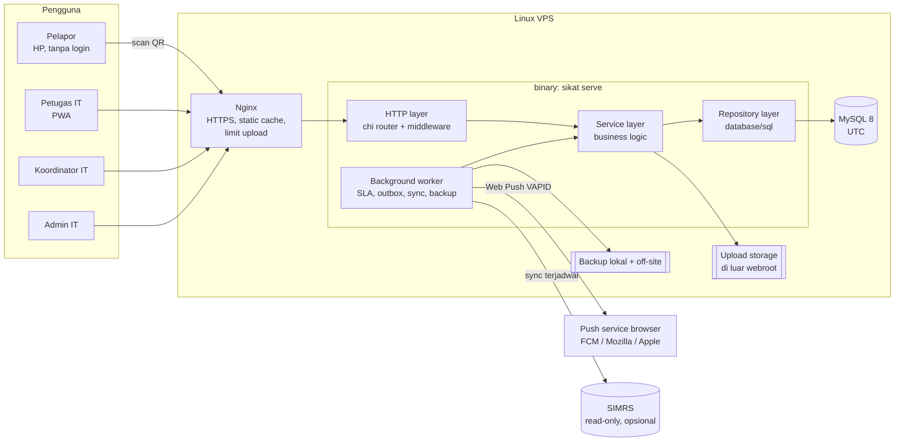
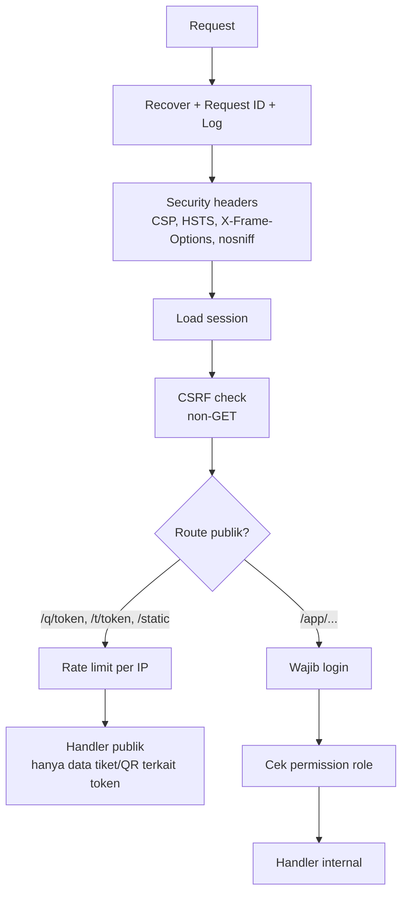
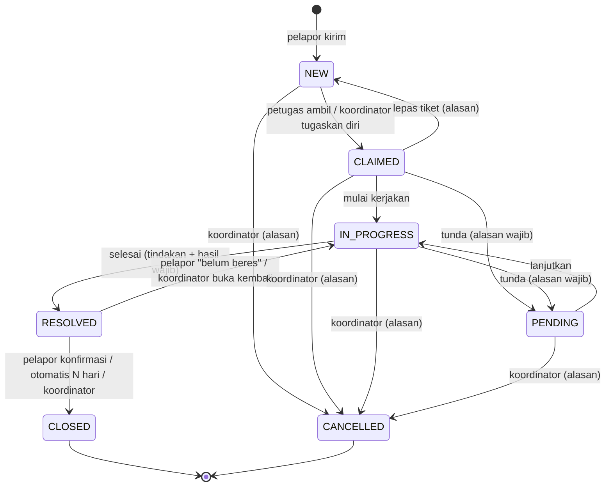
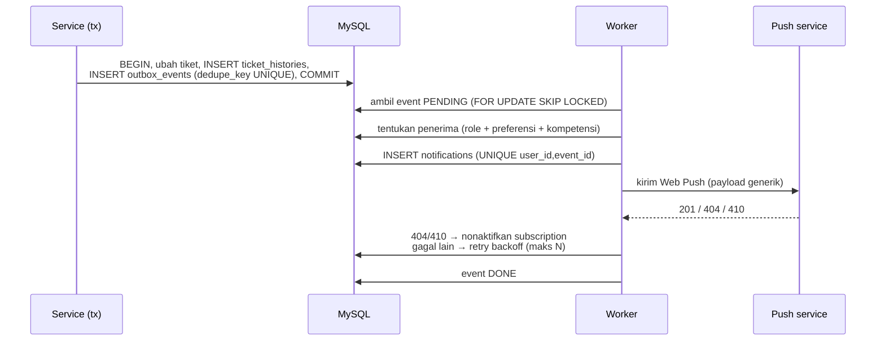

# SIKAT — Arsitektur Sistem

> Sistem Informasi Kelola Aduan & Tindak Lanjut
> Status dokumen: rancangan PHASE 0; bagian fondasi (§2–§5, §10, §11 sebagian)
> sudah diimplementasikan di PHASE 1. Bagian lain diperbarui saat fasenya dikerjakan.

---

## 1. Gambaran Umum

SIKAT adalah **satu aplikasi web server-rendered** (Go + HTML template + HTMX)
dengan **satu database MySQL 8** dan **background worker** yang berjalan di
binary yang sama. Tidak ada SPA terpisah, tidak ada microservice.



### Prinsip arsitektur

| Prinsip | Penerapan |
|---|---|
| Server-rendered | `html/template` + HTMX untuk partial update (antrean, status, form). JS vanilla hanya untuk kamera/kompresi foto, push subscription, service worker. |
| Business logic terpisah | Handler hanya: parse input → panggil service → render. Aturan (prioritas, transisi status, SLA, klaim tiket) hanya ada di service. |
| Satu sumber kebenaran | Semua angka dashboard & laporan dihitung dari tabel transaksi. Tidak ada tabel "laporan" yang diisi manual. |
| Append-only histori | `ticket_histories`, `asset_maintenance_histories`, `audit_logs` tidak pernah di-UPDATE/DELETE (dijaga trigger DB). |
| Pekerjaan berat di luar request | Kirim push, cek SLA, sinkronisasi SIMRS, backup, generate export besar → worker. |
| Konfigurasi di database | Prioritas, SLA, kalender, ambang kerusakan berulang, preferensi notifikasi → tabel konfigurasi, dapat diubah admin. |
| Bisa jalan tanpa SIMRS | Integrasi berupa interface; implementasi awal `LocalProvider` membaca master data lokal. |

---

## 2. Technology Stack (keputusan)

Pilihan paling sederhana & stabil sesuai master prompt. Versi pasti dikunci di
`go.mod` pada PHASE 1.

| Kebutuhan | Pilihan | Alasan |
|---|---|---|
| Bahasa | Go (toolchain lokal 1.27) | Single binary, mudah deploy. |
| Router | `github.com/go-chi/chi/v5` | Kompatibel `net/http`, middleware sederhana. |
| DB driver | `github.com/go-sql-driver/mysql` | Standar de facto. DSN: `parseTime=true&loc=UTC&time_zone='+00:00'`. |
| Akses data | **Repository pattern**, SQL ditulis tangan + `database/sql` | Tidak perlu tool generator tambahan; query eksplisit & mudah diaudit. |
| Migrasi | `github.com/pressly/goose/v3` dengan file SQL ter-embed | Up/down, versi tercatat, berjalan dari binary (`sikat migrate up`). |
| Template | `html/template` (auto-escape XSS), di-embed via `embed.FS` | Single binary, tidak ada file template tercecer di server. |
| CSS | Tailwind CSS **standalone CLI** (build saat development/CI) | Tidak butuh Node di server produksi; output satu file CSS. |
| Interaksi | HTMX (di-vendor ke `static/js`, bukan CDN) | Jaringan RS bisa membatasi CDN; aset lokal lebih andal. |
| Session | `github.com/alexedwards/scs/v2` + store MySQL | Session server-side, cookie `HttpOnly; Secure; SameSite=Lax`, rotasi ID saat login. |
| CSRF | `http.CrossOriginProtection` (stdlib) **+** token sinkron per-session di form/HTMX header | Dua lapis; token tetap ada untuk browser lama. |
| Password | Argon2id (`golang.org/x/crypto/argon2`) | Sesuai master prompt. |
| Rate limit | `golang.org/x/time/rate`, in-memory per IP/route | Cukup untuk 1 instance; dicatat sebagai batasan bila nanti multi-instance. |
| QR | `github.com/skip2/go-qrcode` | PNG langsung dari Go, tanpa layanan luar. |
| Web Push | Pustaka standar Go (`crypto/ecdh`, `crypto/hkdf`, `crypto/ecdsa`) | **Diputuskan PHASE 6:** RFC 8291 + RFC 8292 tanpa dependensi luar (diuji dekripsi sisi browser). |
| Excel | `github.com/xuri/excelize/v2` | Library XLSX Go paling matang. |
| PDF | `github.com/go-pdf/fpdf` | **Diputuskan PHASE 7:** pure Go, tabel dengan teks terbungkus & header berulang per halaman. Font standar Helvetica → teks PDF dinormalkan ke ASCII (aksen dilepas, tanda baca diganti padanannya). |
| Gambar | `image/jpeg`, `image/png`, `golang.org/x/image/webp` | Validasi isi file + re-encode untuk membuang metadata EXIF/GPS. |
| Test | `testing` stdlib + MySQL test database nyata | Uji konkurensi & transaksi harus ke MySQL sungguhan, bukan mock. |

Tidak dipakai (sengaja): ORM, React/Vue, Redis, message broker, Docker
sebagai syarat wajib. Antrian pekerjaan cukup tabel MySQL (`outbox_events`).

---

## 3. Struktur Proyek

Mengikuti master prompt bagian 22, dengan pemisahan per modul:

```
cmd/
  server/            main.go → subcommand: serve | migrate | create-admin | vapid-keys
internal/
  config/            baca env/.env, validasi saat start (gagal cepat bila kurang)
  database/          koneksi, helper transaksi (WithTx), migrasi ter-embed
  middleware/        auth, RBAC, CSRF, rate limit, security headers, recover, request log
  auth/              login, logout, session, hash password
  users/             akun, role, kompetensi petugas
  departments/       unit
  rooms/             ruangan
  assets/            perangkat, kategori perangkat, alert kerusakan berulang
  maintenance/       riwayat pemeliharaan, sparepart
  qrcodes/           token QR, PNG, cetak massal
  tickets/           pengajuan publik, detail, komentar, lampiran, nomor tiket
  assignments/       klaim, ambil alih, lepas, anggota pendukung
  workflows/         state machine status tiket
  priority/          rule engine prioritas
  sla/               kalender kerja, kalkulasi due date & waktu terpakai
  escalation/        pengecekan SLA, pencatatan eskalasi (idempoten)
  activities/        kegiatan internal IT
  notifications/     outbox, inbox, push subscription, preferensi
  reports/           query laporan, export XLSX/PDF
  integrations/      provider interface, LocalProvider, CSV import, sync log
  audit/             audit log
  worker/            scheduler + leader lock (GET_LOCK)
  web/               render template, flash message, helper format waktu
templates/
  layouts/ components/ auth/ dashboard/ tickets/ assets/ maintenance/
  sla/ activities/ reports/ master/ integrations/ public/
static/
  css/ js/ icons/ images/   (manifest.webmanifest, sw.js di root static)
migrations/          0001_init.sql, ...
tests/               test integrasi lintas modul (butuh MySQL test)
docs/
```

Setiap modul berisi file terpisah sesuai kebutuhan:

```
internal/tickets/
  model.go        struct domain + konstanta status
  validation.go   validasi input (pesan error Bahasa Indonesia)
  repository.go   SQL (hanya terima *sql.Tx / DBTX)
  service.go      aturan bisnis, mengatur transaksi
  handler.go      HTTP: parse → service → render
  service_test.go
```

**Penyesuaian saat implementasi (PHASE 1):**

- Unit, ruangan, dan katalog sederhana (bidang, jenis gangguan, kategori
  perangkat, alasan tunda, jenis kegiatan, template tindakan, sparepart) dikelola
  oleh satu paket `internal/master` yang mendeskripsikan tiap entitas secara
  deklaratif (`entities.go`). Ini menggantikan 9 salinan kode CRUD yang hampir
  identik. Nama tabel/kolom adalah konstanta kode; semua nilai tetap parameter SQL.
  Folder `internal/departments` dan `internal/rooms` karenanya tidak dibuat.
- Entitas dengan aturan bisnis sendiri tetap punya paket khusus:
  `internal/assets`, `internal/users`, `internal/settings`.
- Paket tambahan: `internal/rbac` (role & permission, tanpa dependensi),
  `internal/reqctx` (data per-request), `internal/web` (render template),
  `internal/server` (perakitan rute), `internal/dashboard`, `internal/testutil`.
- Template berada di `templates/<modul>/`; setiap halaman memanggil layout
  `base` (internal) atau `public` (login/error).

**Penyesuaian PHASE 2:**

- Aturan prioritas dikelola lewat engine master (`priority-rules`); kondisi
  "perangkat pengganti" memakai pilihan kombinasi siap pakai (mis. "Tidak ada atau
  tidak tahu") yang disimpan ke kolom `SET`. Logika evaluasi ada di `internal/priority`.
- Paket `internal/qrcodes`, `internal/attachments`, `internal/tickets`
  (berisi pengajuan, penomoran, klaim, antrean; `internal/assignments` dan
  `internal/workflows` akan dipisah saat PHASE 3 bila logikanya membesar).
- Outbox notifikasi (§7) belum ditulis di PHASE 2 agar tidak menumpuk event tanpa
  konsumen; mulai ditulis di PHASE 6 bersama worker-nya.
- FK kolom SLA di `tickets` ditambahkan di migrasi PHASE 5; FK lampiran untuk
  kegiatan/pemeliharaan ditambahkan di PHASE 3/4.

**Penyesuaian PHASE 3:**

- State machine murni di `internal/workflows` (tanpa DB, diuji matriks penuh);
  eksekusi transisi, penugasan, dan hak akses per aksi ada di `internal/tickets/workflow.go`
  (paket `assignments` tidak dipisah karena logikanya kecil dan terikat transaksi tiket).
- Aturan hak aksi: perubahan status hanya oleh penanggung jawab utama; koordinator
  harus mengambil alih dulu. Tutup/buka kembali/ubah prioritas oleh koordinator;
  batal oleh koordinator/admin.
- Worker (`internal/worker`) dijalankan dari `sikat serve`; leader lock pada koneksi
  khusus, job dihentikan bila koneksi lock putus.
- Nomor urut tahunan dipindah ke `database.NextSequence` (dipakai TKT dan KEG).

**Penyesuaian PHASE 4:**

- `internal/maintenance` mengimplementasikan antarmuka `tickets.Hooks` dan
  `activities.Hooks`; kait dipanggil di dalam transaksi tiket/kegiatan sehingga
  riwayat perangkat dan deteksi kerusakan berulang ikut batal bila transaksi gagal.
  Modul tiket & kegiatan tidak mengimpor `maintenance` (tidak ada siklus impor).
- Koreksi riwayat memakai pembatalan (void) beralasan, bukan hapus/ubah diam-diam;
  trigger DB menolak DELETE.
- Keputusan koordinator atas peringatan "mereset" penghitungan: gangguan dihitung
  sejak keputusan terakhir (dalam jendela waktu), agar tidak langsung muncul peringatan baru.

Aturan dependensi: `handler → service → repository`. Service boleh memanggil
service modul lain lewat interface kecil (mis. `tickets.Service` memakai
`priority.Engine`, `sla.Calculator`, `notifications.Publisher`). Repository tidak
pernah memanggil service.

---

## 4. Alur Request & Lapisan Keamanan



Pemisahan rute:

| Prefix | Akses | Isi |
|---|---|---|
| `/q/{qrToken}` | Publik, rate-limited | Form pengajuan dengan lokasi/perangkat terisi. |
| `/t/{ticketToken}` | Publik, rate-limited | Status & perkembangan satu tiket; konfirmasi selesai. |
| `/login` | Publik, rate-limited ketat | Login petugas. |
| `/app/...` | Login + RBAC | Dashboard, antrean, master data, laporan. |
| `/static/...`, `/sw.js`, `/manifest.webmanifest` | Publik, cache | Aset. |

Token publik **tidak pernah** berupa ID berurutan:

- QR token: 16 byte `crypto/rand` → base62 (~22 karakter). Disimpan apa adanya (bukan rahasia tinggi, tapi tidak bisa ditebak).
- Ticket token: 32 byte `crypto/rand` → base64url. Yang disimpan di DB hanya **SHA-256**-nya; token asli hanya muncul di halaman konfirmasi/link.

Halaman publik tidak memiliki link apa pun ke `/app`, dan handler publik hanya
membaca data melalui query yang dibatasi token.

---

## 5. Model RBAC

Tiga role sistem (`ADMIN`, `COORDINATOR`, `TECHNICIAN`). Pelapor **bukan** user.
Permission didefinisikan di kode sebagai matriks (mudah diuji & diaudit); tabel
`roles` menyimpan role dan nama tampilannya. Admin mengelola akun dan menetapkan
role.

| Permission (contoh) | ADMIN | COORDINATOR | TECHNICIAN |
|---|:-:|:-:|:-:|
| `ticket.view_queue` | ✓ | ✓ | ✓ |
| `ticket.claim` | – | ✓ | ✓ |
| `ticket.take_over` | – | ✓ | – |
| `ticket.change_priority` (wajib alasan) | – | ✓ | – |
| `ticket.cancel` (wajib alasan) | ✓ | ✓ | – |
| `ticket.update_own` (status, tindakan, foto, pendukung) | – | ✓ | ✓ |
| `activity.create` | – | ✓ | ✓ |
| `activity.manage_all` | – | ✓ | – |
| `asset.view_history` | ✓ | ✓ | ✓ |
| `report.view_all` | ✓ | ✓ | – |
| `report.view_own` | – | – | ✓ |
| `master.manage` (unit, ruangan, perangkat, kategori, QR) | ✓ | – | – |
| `config.manage` (SLA, prioritas, notifikasi, sistem) | ✓ | – | – |
| `user.manage` | ✓ | – | – |
| `integration.manage` | ✓ | – | – |

**Koordinator per bidang** (diputuskan 13/11/2026, migrasi `00009`): setiap bidang
(`it_categories.coordinator_user_id`) memiliki tepat satu koordinator; satu
koordinator boleh memegang beberapa bidang (diatur Admin di Master Data › Bidang).

- Koordinator tetap **melihat** semua tiket dan laporan, tetapi notifikasi,
  dashboard, dan antrean bawaan hanya untuk bidangnya (antrean punya opsi
  "Tampilkan semua bidang").
- Tindakan koordinator — ambil alih, ubah prioritas, batalkan, tutup, buka
  kembali, atur anggota tim — hanya untuk tiket bidangnya (`tickets.requireField`);
  catatan internal dan foto tetap boleh. Admin tidak terkena batasan ini.
- Notifikasi ke koordinator: hanya koordinator bidang tiket, ditambah koordinator
  yang menjadi anggota tim tiket tersebut.
- **Cadangan:** bidang tanpa koordinator aktif (kosong, akun nonaktif, atau role
  bukan Koordinator) → notifikasi ke semua koordinator dan semua koordinator boleh
  menindak. Dashboard Admin menampilkan peringatan bidang tanpa koordinator.

**Triase & koreksi jenis gangguan** (16/11/2026, migrasi `00010`):

- Bidang tiket diturunkan dari jenis gangguan pilihan pelapor (`ticket_categories.it_category_id`,
  disalin ke tiket). Satu bidang ditandai `is_triage` (unik): "Triase / Belum
  terklasifikasi"; jenis "Lainnya" dipetakan ke sana.
- Tiket triase: terlihat di antrean "tersedia" semua petugas dan dinotifikasi ke
  semua petugas (tanpa syarat kompetensi), ditandai "Perlu dipilah".
- `tickets.Service.ChangeCategory`: penanggung jawab tiket, atau koordinator bidang
  tiket saat ini, mengganti jenis gangguan tiket aktif (bukan Selesai/Ditutup/
  Dibatalkan). Bidang mengikuti jenis baru, kebijakan SLA dipilih ulang
  (`sla_revision` naik), histori `CATEGORY_CHANGED`, jenis pilihan pelapor
  disimpan di `reported_ticket_category_id`. Alasan wajib kecuali memilah dari Triase.
- Bila bidang berubah → event `TICKET_TRANSFERRED`: koordinator bidang baru, serta
  petugas berkompetensi bidang baru (tiket belum diambil) atau anggota tim (sudah diambil).
- Laporan "Pemilahan jenis gangguan" menampilkan tiket triase/dikoreksi beserta
  keterangan pelapor, sebagai bahan Admin menambah jenis gangguan baru.

> Asumsi: satu user = satu role. Bila Admin IT juga ikut menangani tiket, ia
> membutuhkan akun kedua atau role digabung — lihat pertanyaan terbuka di
> `IMPLEMENTATION_PLAN.md`.

---

## 6. Domain Inti

### 6.1 Nomor tiket & kegiatan

Format `TKT-2026-000001` / `KEG-2026-000001`, reset per tahun (zona Asia/Makassar).
Dibuat atomik dalam transaksi yang sama dengan insert tiket:

```sql
INSERT INTO number_sequences (name, year, current_value) VALUES ('TKT', 2026, LAST_INSERT_ID(1))
  ON DUPLICATE KEY UPDATE current_value = LAST_INSERT_ID(current_value + 1);
SELECT LAST_INSERT_ID();   -- nilai per koneksi; baris terkunci sampai COMMIT
```

`LAST_INSERT_ID(expr)` dipakai di kedua cabang (baris baru maupun update) sehingga
nilai yang dibaca selalu nomor yang baru dialokasikan. Baris sequence terkunci
hingga transaksi selesai, jadi dua pengajuan bersamaan mendapat nomor berbeda.
Bila transaksi rollback, nomor ikut rollback — tidak ada lubang dari kegagalan biasa.

### 6.2 Mesin prioritas otomatis

Input dari form pelapor (pilihan siap pakai, bukan istilah teknis) + data yang
dihitung sistem:

| Faktor | Sumber | Nilai |
|---|---|---|
| Jenis gangguan | Dipilih pelapor (`ticket_categories`) | kategori + bidang |
| Dampak pelayanan | Pertanyaan "Apakah pelayanan terganggu?" | 0 Tidak mengganggu, 1 Sebagian terganggu, 2 Pelayanan berhenti |
| Jumlah terdampak | "Siapa saja yang terdampak?" | 1 Saya sendiri, 2 Beberapa orang, 3 Satu unit, 4 Lebih dari satu unit |
| Perangkat pengganti | "Ada perangkat lain yang bisa dipakai?" | YES / NO / UNKNOWN |
| Layanan klinis kritis | **Otomatis** dari flag unit/ruangan (`is_critical_service`) | ya / tidak |

Aturan (`priority_rules`) dievaluasi **berurutan (sort_order), aturan pertama
yang cocok menang** — seperti daftar aturan firewall. Setiap kondisi bisa
dikosongkan (= apa saja). Bila tidak ada yang cocok → `default_priority`
kategori gangguan. Hasil menyimpan `priority_rule_id` sehingga selalu bisa
dijelaskan "mengapa prioritasnya Tinggi".

Contoh aturan awal (seed konfigurasi, bisa diubah admin):

| # | Kondisi | Hasil |
|---|---|---|
| 1 | Layanan klinis kritis **dan** dampak = berhenti **dan** terdampak ≥ satu unit | KRITIS |
| 2 | Terdampak ≥ satu unit **dan** dampak = berhenti | TINGGI |
| 3 | Dampak = berhenti **dan** pengganti = tidak ada | TINGGI |
| 4 | Terdampak ≤ beberapa orang **dan** pengganti = ada | SEDANG |
| 5 | Dampak = tidak mengganggu | RENDAH |
| – | (tidak cocok) | default kategori |

Admin mendapat halaman **"Uji aturan"**: isi jawaban contoh → lihat prioritas
hasil dan aturan yang cocok, sebelum menyimpan perubahan.

Koordinator dapat mengubah prioritas dengan alasan wajib → `priority_source =
MANUAL`, tercatat di histori, SLA dihitung ulang sesuai kebijakan prioritas baru.

### 6.3 Klaim tiket (anti-rebutan)

Satu statement atomik di dalam transaksi:

```sql
UPDATE tickets
   SET assignee_id = ?, status = 'CLAIMED', first_response_at = COALESCE(first_response_at, ?),
       version = version + 1, updated_at = ?
 WHERE id = ? AND status = 'NEW' AND assignee_id IS NULL;
-- RowsAffected == 1 → berhasil: insert ticket_assignments + ticket_histories + outbox_event
-- RowsAffected == 0 → "Tiket sudah diambil oleh <nama>" (dibaca ulang lalu ditampilkan)
```

Pertahanan kedua di level DB: `ticket_assignments` punya kolom generated
`active_primary_ticket_id` dengan UNIQUE index, sehingga mustahil ada dua
penanggung jawab utama aktif untuk satu tiket (lihat `DATABASE.md`).

Ambil alih koordinator: `SELECT ... FOR UPDATE` pada tiket, tutup assignment
lama (`released_at`, alasan), buat assignment baru, histori `TAKEN_OVER`.

### 6.4 Workflow status



`workflows` berisi tabel transisi yang diizinkan + syarat (role, field wajib).
Setiap transisi: timestamp UTC, user pelaksana (atau "Pelapor"/"Sistem"),
catatan opsional, entri `ticket_histories`, dan `outbox_event` untuk notifikasi.

Saat **RESOLVED** dan tiket terhubung ke perangkat, sistem otomatis membuat
entri `asset_maintenance_histories` dari data penyelesaian (tindakan, hasil,
sparepart, biaya, durasi) — petugas tidak mengetik ulang.

### 6.5 SLA

- **Kebijakan** (`sla_policies`) dicocokkan berdasarkan prioritas + kategori +
  bidang + unit; yang paling spesifik menang.
- Nilai kebijakan **disalin** ke tiket saat dibuat (`sla_response_minutes`,
  `sla_resolution_minutes`, `sla_calendar_id`) supaya perubahan kebijakan tidak
  mengubah histori.
- **Kalender** (`sla_calendars`, `sla_calendar_hours`, `sla_holidays`): 24/7 atau
  jam operasional per hari + hari libur, zona Asia/Makassar.
- **Penundaan SLA hanya bila dikonfigurasi**: alasan tunda (`pending_reasons`)
  memiliki flag `pauses_sla` dan kebijakan memiliki `allow_pause`. Tanpa
  keduanya, waktu tetap berjalan saat PENDING. Saat keluar dari PENDING, jeda
  (menit operasional) diakumulasi ke `sla_paused_minutes` dan `resolution_due_at`
  digeser sebesar jeda tersebut.
- **Siklus & revisi** (implementasi PHASE 5): `sla_cycle_started_at` adalah awal
  target penyelesaian (dibuat / dibuka ulang). Dibuka ulang = siklus baru dengan
  batas baru; target respons hanya berlaku di siklus pertama. Perubahan prioritas
  memilih ulang kebijakan, menghitung ulang batas waktu, dan menaikkan
  `sla_revision` (kolom `level` di `sla_escalations`) sehingga peringatan untuk
  target baru tetap tercatat.
- **Kalender diubah** → batas waktu tiket aktif yang memakai kalender itu
  dihitung ulang (`sla.Service.RecomputeDue`). Tampilan selalu dihitung langsung
  dari kalender saat ini (`sla.Evaluate`).
- Konfigurasi: Master Data → **Kebijakan SLA** (entitas master generik) dan
  **Kalender kerja** (`/app/sla/calendars`: jam per hari + hari libur). Dashboard
  `/app/sla` dan laporan bulanan `/app/sla/report` untuk Koordinator & Admin
  (permission `sla.view`).

Tiga ukuran waktu dilaporkan terpisah:

| Ukuran | Rumus |
|---|---|
| Waktu kalender | `t_akhir − created_at` |
| Waktu operasional | menit di dalam jam kerja kalender antara dua titik |
| Waktu operasional bersih | waktu operasional − menit tertunda yang menghentikan SLA |

`sla.Calculator` murni (tanpa DB): `AddBusinessMinutes(start, n, cal)` dan
`BusinessMinutesBetween(a, b, cal)`. Inilah bagian yang paling banyak diuji
(lintas tengah malam, akhir pekan, hari libur, mulai di luar jam kerja).

Status tampilan: **Aman** (< ambang peringatan, default 75%), **Peringatan**
(≥ ambang), **Terlambat** (≥ 100%).

### 6.6 Eskalasi

Worker tiap 1 menit (konfigurasi) memindai tiket aktif berdasarkan index
`response_due_at` / `resolution_due_at`. Setiap kejadian ditulis ke
`sla_escalations` dengan UNIQUE `(ticket_id, kind, cycle, level)`:

```sql
INSERT IGNORE INTO sla_escalations (ticket_id, kind, cycle, ...) VALUES (...);
-- RowsAffected == 1 → kejadian baru → histori + outbox_event
-- RowsAffected == 0 → sudah pernah, tidak kirim lagi
```

`cycle` naik bila tiket dibuka kembali, sehingga pelanggaran baru tetap
tercatat tanpa menduplikasi yang lama. Prioritas KRITIS membuat kejadian
`CRITICAL_IMMEDIATE` saat tiket dibuat (atau saat prioritas dinaikkan ke Kritis).

Implementasi PHASE 5: `INSERT ... ON DUPLICATE KEY UPDATE id = id` (bukan
`INSERT IGNORE`, agar error lain tidak tertelan). Kejadian baru juga menulis
histori tiket (`SLA_CRITICAL`, `SLA_WARNING`, `SLA_BREACH`) dan mengisi
`response_breached_at` / `resolution_breached_at`. Pelanggaran yang baru
diketahui saat tiket diambil/diselesaikan (worker belum sempat berjalan) dicatat
dengan `notify = FALSE` — masuk laporan, tanpa notifikasi. Worker memuat seluruh
tiket aktif dan mengevaluasinya dengan kalender di memori (volume tiket aktif RS
kecil), sehingga tiket yang dijeda dan batas waktu yang bergeser tertangani tanpa
index khusus. Laporan bulanan berbasis tiket yang dibuat pada bulan itu.

### 6.7 Kerusakan berulang

Setelah tiket dengan `asset_id` dibuat, service menghitung jumlah tiket perangkat
tersebut dalam `repeat_damage.window_days` (default 90) terakhir. Bila ≥
`repeat_damage.threshold` (default 3) dan belum ada `asset_alerts` berstatus OPEN
untuk perangkat itu → buat alert + notifikasi koordinator:

> "Perhatian: Komputer IGD-01 telah mengalami 5 gangguan dalam 90 hari terakhir."

Rekomendasi berbasis aturan (konfigurasi), **bukan keputusan**:

| Kondisi | Rekomendasi |
|---|---|
| jumlah ≥ ambang | Evaluasi perangkat |
| jumlah ≥ ambang × 1,5 **atau** gangguan kategori sama berulang | Pemeriksaan lanjutan |
| di atas + umur perangkat ≥ N tahun **atau** total biaya ≥ batas | Pertimbangan penggantian |

Koordinator menutup alert dengan keputusan & catatan (tercatat di histori perangkat).

---

## 7. Notifikasi (event-based)



- **Outbox** ditulis dalam transaksi yang sama dengan perubahan data → tidak ada
  notifikasi untuk perubahan yang gagal, dan tidak ada perubahan tanpa notifikasi.
- **Deduplikasi** dua lapis: `outbox_events.dedupe_key` dan
  `notifications (user_id, event_id)`.
- **Inbox in-app** selalu terisi; push hanya pelengkap.
- **Payload lock screen generik**, contoh: judul "SIKAT", isi "Tiket baru
  prioritas Kritis · TKT-2026-000123". Tanpa nama ruangan, deskripsi, atau nama
  pelapor. Detail hanya terlihat setelah membuka aplikasi (login).
- Implementasi PHASE 6 (`internal/notifications`):
  - Event: `TICKET_CREATED` (non-kritis), `TICKET_CRITICAL` (dari eskalasi SLA
    `CRITICAL_IMMEDIATE`), `TICKET_CLAIMED/STARTED/PENDING/RESOLVED/REOPENED`,
    `TICKET_ASSIGNED` (anggota pendukung ditambahkan / tiket diambil alih — hanya
    orang bersangkutan), `SLA_WARNING`, `SLA_BREACH`, `REPEAT_DAMAGE`, `TEST`.
    Histori tiket menulis outbox lewat `repository.addHistory` (dedupe `h:<id histori>`);
    eskalasi SLA lewat `sla.Record` (dedupe `sla:<id eskalasi>`, `notify = FALSE` tidak
    menulis outbox); kerusakan berulang saat peringatan dibuat (`asset_alert:<id>`).
  - Penerima: Koordinator/Admin = seluruh anggota role sesuai preferensi; Petugas
    dibatasi relevansi — tiket baru/kritis/diambil & SLA respons → kompetensi sesuai
    (atau tanpa kompetensi); mulai/tunda/selesai/dibuka ulang & SLA penyelesaian →
    anggota tim tiket. Pelaku dikecualikan.
  - Worker `kirim-notifikasi` (5 detik): fan-out per event dalam transaksinya sendiri;
    gagal → jeda 1, 2, 4, 8 menit, `FAILED` setelah 5 kali. Push per perangkat di
    `push_deliveries`: 2xx terkirim; 404/410 → langganan dinonaktifkan; 401/403 →
    nonaktif (kunci VAPID berubah); 429/5xx/jaringan → retry (maks. 5); push yang
    berumur > 1 jam tidak dikirim (`EXPIRED`). Tag per tiket sehingga kabar terbaru
    menggantikan yang lama di perangkat. `bersih-notifikasi` harian menghapus data > 180 hari.
  - Web Push ditulis dengan pustaka standar Go (RFC 8291 aes128gcm + RFC 8292 VAPID
    ES256), tanpa dependensi luar. Kunci dari env `SIKAT_VAPID_*`; tanpa kunci, push
    nonaktif dan inbox tetap berjalan.
  - Perangkat bersama: logout menghapus langganan perangkat yang dipakai login itu;
    sinkron otomatis hanya untuk pengguna yang mengaktifkan push di perangkat tersebut.
  - PWA: `/manifest.webmanifest` & `/sw.js` (scope `/`) dibuat server dengan versi dari
    hash aset; service worker hanya menyimpan aset statis berversi dan halaman `/offline`
    (dirender tanpa session) — halaman berisi data tidak pernah disimpan di cache.
    Manifest hanya dimuat di halaman setelah login.
- Preferensi per role (`notification_preferences`): event apa yang diterima
  role tersebut, lewat inbox saja atau inbox + push.

---

### 7.1 Dashboard & laporan (implementasi PHASE 7)

- Paket `internal/reports`: setiap laporan menghasilkan `Table` generik (kolom
  bertipe teks/angka/durasi/persen/uang/tanggal, baris, total, ringkasan, catatan,
  grafik opsional). Satu template HTML dan satu penulis Excel/PDF melayani semua
  laporan, sehingga angka di layar dan di file selalu sama.
- 15 laporan (master prompt §18): laporan koordinator, rekap bulanan, per bidang,
  per unit, per petugas, per prioritas, tertunda, SLA, waktu respons, waktu
  penyelesaian, beban kerja, kegiatan internal, perangkat sering rusak, riwayat
  pemeliharaan, downtime.
- Filter: bulan / tahun / rentang tanggal (maks. 2 tahun), unit, bidang, petugas,
  prioritas, status. Batas periode dihitung dalam WITA lalu dikonversi ke UTC;
  pengelompokan per hari/bulan memakai offset tetap +8 jam (WITA tanpa DST).
- Definisi angka: tiket dihitung menurut tanggal masuk; waktu respons/penyelesaian
  adalah waktu kalender (median & persentil 90 dihitung di Go); kepatuhan SLA dari
  buku besar `sla_escalations` (jam kerja & hari libur, termasuk siklus dibuka ulang).
- Laporan koordinator (pengganti spreadsheet): gabungan tiket yang masuk dan
  kegiatan internal pada periode, kolom No, Tanggal, Unit/Bagian, Bidang, Kegiatan,
  Pelaksana, Pendukung, Status, Hasil/Keterangan.
- Hak akses: `report.view_all` (Admin, Koordinator) melihat semua; `report.view_own`
  (Petugas) dipaksa ke data pribadi — tiket & kegiatan tempat ia PJ/pendukung.
- Ekspor Excel (`excelize`, angka tetap angka, filter & panel beku) dan PDF A4
  landscape; setiap ekspor dicatat di audit (`report.export`). Ekspor sinkron
  dengan batas 20.000 baris; tampilan HTML menampilkan 500 baris pertama.
- Grafik rekap bulanan: SVG dirender server (tanpa JavaScript, sesuai CSP), palet
  brand-600 (biru logo)/amber-600/violet-500 yang lolos validasi buta warna; tabel di bawahnya
  adalah tampilan data lengkap.
- Dashboard per role (`internal/dashboard`): petugas (tiket tersedia/saya, SLA
  mendekati batas, beban kerja tim), koordinator (ringkasan bulan berjalan, kinerja
  petugas, distribusi gangguan, kegiatan internal, perangkat sering rusak), admin
  (status database, worker, antrean notifikasi, Web Push; integrasi SIMRS dan
  backup ditampilkan apa adanya sebagai belum tersedia sampai PHASE 8/9).

## 8. Background Worker

Berjalan sebagai goroutine dalam `sikat serve` (bisa dimatikan dengan
`--worker=false`). Agar aman bila suatu saat ada 2 instance, worker mengambil
`GET_LOCK('sikat_worker', 0)` — hanya pemegang lock yang menjalankan job.

| Job | Interval default | Idempoten via |
|---|---|---|
| Proses outbox → inbox + push | 5 detik | status event + UNIQUE |
| Cek SLA & eskalasi | 60 detik | `sla_escalations` UNIQUE |
| Auto-close tiket RESOLVED > N hari | 1 jam | kondisi status di WHERE |
| Sinkronisasi master data (bila aktif) | per konfigurasi | `external_id_mappings` + hash |
| Backup database (`mysqldump` + gzip) | harian 02:00 WITA | `backup_logs` per tanggal |
| Bersih session kedaluwarsa | 1 jam | – |

Setiap job: panic recovery, log terstruktur (`log/slog`), retry dengan backoff
untuk error sementara, waktu eksekusi tercatat.

---

## 9. Integrasi SIMRS

```go
type OrganizationProvider interface { ListDepartments(ctx context.Context) ([]ExtDepartment, error) }
type RoomProvider         interface { ListRooms(ctx context.Context) ([]ExtRoom, error) }
type AssetProvider        interface { ListAssets(ctx context.Context) ([]ExtAsset, error) }
```

- `LocalProvider` (PHASE 8 awal): sumber = tabel lokal; sync = no-op yang jujur
  ("sumber data: lokal"). Aplikasi berjalan penuh tanpa SIMRS.
- `CsvImportProvider`: unggah CSV → pratinjau → terapkan.
- `SimrsApiProvider` / `SimrsDatabaseProvider`: dibuat **hanya ketika** spesifikasi
  SIMRS tersedia. Tidak ada integrasi palsu.

Implementasi PHASE 8 (`internal/integration`, migrasi `00011`): `LocalProvider`
(default), impor CSV dengan pratinjau (transaksi yang dibatalkan), tabel
`integration_configs`, `integration_sync_logs`, `external_id_mappings`,
`integration_imports`. Direktori `employees` dihapus di migrasi `00018`: saran
nama pelapor di form catat tiket diambil dari API pegawai SIMRS (`internal/simrs`,
sama dengan aplikasi CSSD), disimpan di memori 1 jam tanpa data pribadi. Worker `sinkron-master` menjalankan sinkron terjadwal &
percobaan ulang untuk provider SIMRS yang terdaftar (`RegisterProvider`) — kosong
sampai spesifikasi SIMRS tersedia. Rincian & format CSV: `docs/INTEGRATION.md`.

Aturan sinkronisasi:
1. Pemetaan via `external_id_mappings (source, entity_type, external_id) → local_id`; tidak ada FK ke DB SIMRS.
2. Record lokal yang diubah manual setelah sync terakhir (`local_modified_at > last_synced_at`) **tidak ditimpa**; dicatat sebagai konflik di `integration_sync_logs` untuk diputuskan admin.
3. Data yang hilang dari sumber tidak dihapus — ditandai nonaktif.
4. Koneksi DB SIMRS memakai user read-only, query ber-`LIMIT`/paging, timeout pendek, di luar jam sibuk.
5. Setiap run tercatat: mulai, selesai, jumlah tambah/ubah/lewati/konflik/error.

---

## 10. Waktu & Zona

- DB menyimpan `DATETIME(3)` dalam **UTC**. Koneksi dipaksa `time_zone='+00:00'`.
- Go memakai `time.Time` UTC; konversi ke `Asia/Makassar` hanya di lapisan tampilan
  (template func `wita`) dan di kalkulasi kalender SLA.
- Batas "bulan/tahun" laporan dihitung dalam WITA lalu dikonversi ke rentang UTC.
- Binary meng-embed `time/tzdata` agar tidak bergantung pada tzdata server.

---

## 11. Upload & Data Sensitif

- Tipe: JPEG, PNG, WebP; diverifikasi dari magic bytes, bukan ekstensi.
- Ukuran: maks 5 MB per file, maks 3 file per aksi (konfigurasi). Nginx juga membatasi `client_max_body_size`.
- Foto di-**re-encode** di server → metadata EXIF/GPS hilang. Di HP, foto dikompres
  dulu dengan canvas (JS) agar hemat kuota.
- Disimpan di luar webroot dengan nama acak; disajikan lewat handler yang
  memeriksa hak akses (login, atau token tiket yang sesuai).
- Peringatan di form: *"Jangan memotret layar/kertas yang menampilkan data pasien."*
- Form tidak memiliki field nama pasien/diagnosis/no. RM.

---

## 12. Deployment (ringkas)

```
Internet/Intranet ──HTTPS──> Nginx (TLS, gzip, cache /static, client_max_body_size)
                               └─> 127.0.0.1:8080  sikat serve   (systemd, user non-root)
                                         ├─ MySQL 8 (localhost, user aplikasi tanpa SUPER)
                                         ├─ /var/lib/sikat/uploads
                                         └─ /var/backups/sikat  → salinan off-site
```

Rahasia (DSN, kunci session, VAPID private key, kredensial SIMRS) hanya dari
environment / file `.env` ber-permission `600`; tidak pernah di repository.
Kredensial integrasi yang disimpan di DB dienkripsi (AES-GCM, kunci dari env).

Detail lengkap ditulis di `DEPLOYMENT.md` pada PHASE 9.
