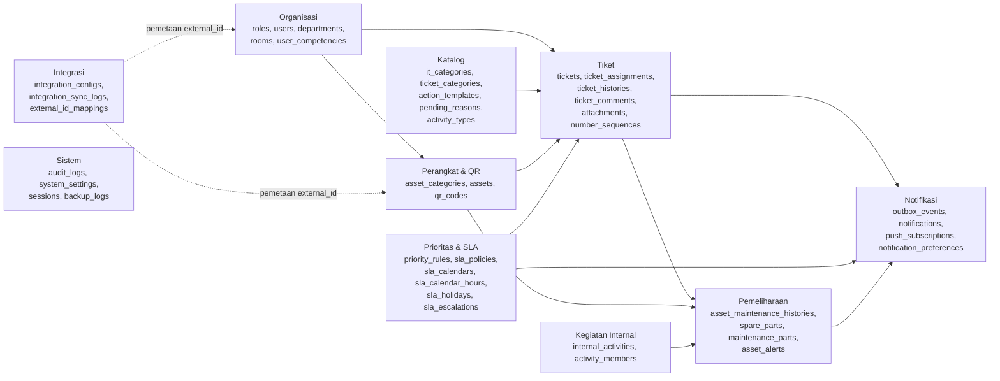
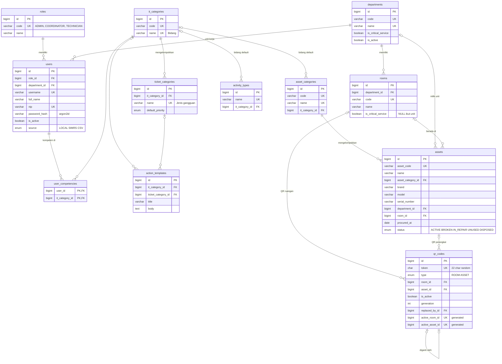
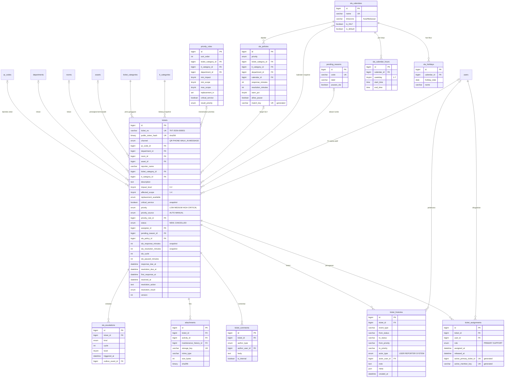
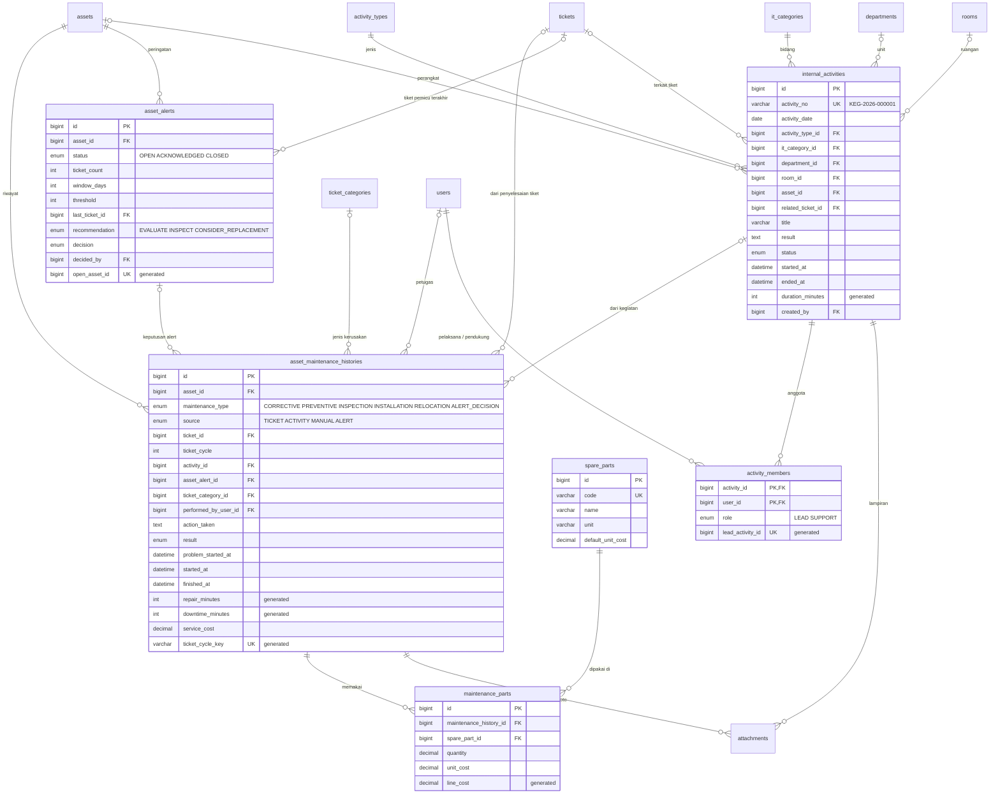

# SIKAT — Entity Relationship Diagram

> Status: **PHASE 0.** Diagram menampilkan kolom kunci & relasi. Kolom lengkap,
> constraint, dan index ada di [`schema-draft.sql`](schema-draft.sql); penjelasan
> di [`DATABASE.md`](DATABASE.md).
>
> Diagram dipecah per domain agar terbaca. Tabel yang muncul di lebih dari satu
> diagram adalah tabel yang sama.

---

## 1. Peta Domain

---

## 2. Organisasi, Katalog, Perangkat & QR

---

## 3. Tiket, Prioritas & SLA

---

## 4. Pemeliharaan Perangkat & Kegiatan Internal

---

## 5. Notifikasi, Integrasi & Sistem

```mermaid
erDiagram
    outbox_events ||--o{ notifications : "menghasilkan"
    outbox_events |o--o{ sla_escalations : "dikirim lewat"
    users ||--o{ notifications : "inbox"
    users ||--o{ push_subscriptions : "perangkat"
    roles ||--o{ notification_preferences : "aturan"
    integration_configs |o--o{ integration_sync_logs : "riwayat sync"
    users |o--o{ integration_sync_logs : "dipicu manual"
    users |o--o{ audit_logs : "pelaku"
    users |o--o{ system_settings : "diubah oleh"

    outbox_events {
        bigint id PK
        varchar event_type
        varchar aggregate_type
        bigint aggregate_id
        json payload
        varchar dedupe_key UK
        enum status "PENDING PROCESSING DONE FAILED"
        int attempts
        datetime next_attempt_at
    }
    notifications {
        bigint id PK
        bigint user_id FK
        bigint event_id FK
        varchar type
        varchar title
        varchar body
        enum severity
        enum push_status
        datetime read_at
    }
    push_subscriptions {
        bigint id PK
        bigint user_id FK
        text endpoint
        binary endpoint_hash UK
        varchar p256dh
        varchar auth_secret
        datetime disabled_at
    }
    notification_preferences {
        bigint id PK
        bigint role_id FK
        varchar event_type
        enum scope "ALL ASSIGNED COMPETENCY"
        boolean inbox
        boolean push
    }
    integration_configs {
        bigint id PK
        enum entity_type UK "DEPARTMENT ROOM EMPLOYEE ASSET"
        enum provider "LOCAL CSV SIMRS_API SIMRS_DB"
        boolean is_enabled
        int schedule_minutes
        json settings
        varbinary secret_ciphertext
        enum conflict_policy
    }
    integration_sync_logs {
        bigint id PK
        bigint config_id FK
        enum entity_type
        enum trigger_type
        enum status
        int inserted
        int updated
        int conflicts
        int failed
        text error_message
    }
    external_id_mappings {
        bigint id PK
        varchar source
        enum entity_type
        varchar external_id
        bigint local_id
        binary source_hash
    }
    audit_logs {
        bigint id PK
        enum actor_type
        bigint actor_user_id FK
        varchar action
        varchar entity_type
        bigint entity_id
        json before_data
        json after_data
        datetime created_at
    }
    system_settings {
        varchar setting_key PK
        text value
        enum value_type
        bigint updated_by FK
    }
    sessions {
        char token PK
        blob data
        timestamp expiry
    }
    backup_logs {
        bigint id PK
        enum status
        datetime started_at
        varchar file_name
        bigint size_bytes
        datetime restore_tested_at
    }
```

> `external_id_mappings.local_id` sengaja **tanpa FK** karena menunjuk ke
> beberapa tabel (sesuai `entity_type`); integritasnya dijaga service
> integrasi. Tidak ada FK ke database SIMRS.
