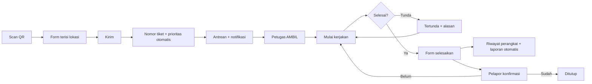

# SIKAT — UI Wireframe

> Status: **PHASE 0.** Wireframe tingkat rendah (struktur & alur), bukan desain
> visual final. Semua teks Bahasa Indonesia. Desain mobile-first: lebar acuan 360 px.

---

## 1. Sistem Visual

| Elemen | Ketentuan |
|---|---|
| Ukuran sentuh | Tombol utama tinggi ≥ 48 px, lebar penuh di HP |
| Huruf | Sistem (`system-ui`), dasar 16 px (mencegah zoom otomatis di iOS) |
| Kontras | WCAG AA; status tidak hanya dibedakan warna (selalu ada teks/ikon) |
| Tata letak | HP: satu kolom + kartu. Tablet: 2 kolom. Desktop: sidebar + tabel |
| Feedback | Setiap aksi → toast/flash ("Tiket berhasil diambil"), tombol berubah "Memproses…" dan nonaktif saat request berjalan (HTMX `hx-disabled-elt`) |
| Bahasa | Hindari istilah teknis di sisi pelapor ("Ceritakan kendalanya", bukan "Deskripsi insiden") |

### Warna status (konsisten di seluruh aplikasi)

| Status | Label | Warna |
|---|---|---|
| NEW | Baru Masuk | biru |
| CLAIMED | Diterima | indigo |
| IN_PROGRESS | Sedang Dikerjakan | kuning/amber |
| PENDING | Tertunda | oranye |
| RESOLVED | Selesai | hijau |
| CLOSED | Ditutup | abu-abu |
| CANCELLED | Dibatalkan | abu-abu bergaris |

### Warna prioritas & SLA

| Prioritas | Warna | | SLA | Warna |
|---|---|---|---|---|
| Rendah | abu-abu | | Aman | hijau |
| Sedang | biru | | Peringatan | amber |
| Tinggi | oranye | | Terlambat | merah |
| Kritis | merah + ikon ⚠ | | | |

---

## 2. Sisi Pelapor (publik, tanpa login)

### 2.1 Form pengajuan — hasil scan QR perangkat

```
┌──────────────────────────────────┐
│  SIKAT · Lapor Gangguan IT       │
├──────────────────────────────────┤
│ 📍 Lokasi terdeteksi             │
│ ┌──────────────────────────────┐ │
│ │ IGD · Ruang Triase           │ │
│ │ Komputer IGD-01 (Dell Opti…) │ │
│ └──────────────────────────────┘ │
│                                  │
│ Nama Anda *                      │
│ [_____________________________]  │  ← diingat di perangkat (localStorage)
│                                  │
│ Unit/bagian Anda                 │
│ [ IGD                        ▼]  │  ← terisi otomatis dari QR
│                                  │
│ Apa masalahnya? *                │
│ ┌────────┐┌────────┐┌────────┐   │
│ │🖥 Kompu-││🖨 Tidak ││🌐 Inter-│   │  ← kartu pilihan besar,
│ │ter mati││ bisa   ││net mati│   │    hanya kategori yang relevan
│ │        ││ cetak  ││        │   │    dengan kategori perangkat
│ └────────┘└────────┘└────────┘   │    tampil lebih dulu
│ ┌────────┐┌────────┐┌────────┐   │
│ │💾 SIMRS ││⌨ Mouse/││ … Lain-│   │
│ │ error  ││keyboard││ nya    │   │
│ └────────┘└────────┘└────────┘   │
│                                  │
│ Ceritakan kendalanya *           │
│ [_____________________________]  │
│ [_____________________________]  │
│                                  │
│ Apakah pelayanan terganggu? *    │
│ ( ) Tidak mengganggu             │
│ ( ) Sebagian terganggu           │
│ ( ) Pelayanan berhenti           │
│                                  │
│ Siapa saja yang terdampak? *     │
│ ( ) Saya sendiri                 │
│ ( ) Beberapa orang               │
│ ( ) Satu unit                    │
│ ( ) Lebih dari satu unit         │
│                                  │
│ Ada perangkat lain yang bisa     │
│ dipakai sementara?               │
│ ( ) Ada  ( ) Tidak ada ( ) Tidak tahu
│                                  │
│ Sejak kapan? (opsional)          │
│ [ Baru saja                  ▼]  │  ← Baru saja / ±1 jam / sejak pagi / kemarin
│                                  │
│ 📷 Tambah foto (opsional, maks 3)│
│ ⚠ Jangan memotret layar/kertas   │
│   yang berisi data pasien.       │
│                                  │
│ No. HP/ekstensi (opsional)       │
│ [_____________________________]  │
│                                  │
│ ┏━━━━━━━━━━━━━━━━━━━━━━━━━━━━━━┓ │
│ ┃        KIRIM LAPORAN          ┃ │
│ ┗━━━━━━━━━━━━━━━━━━━━━━━━━━━━━━┛ │
│ Untuk keadaan darurat medis,     │
│ ikuti prosedur darurat RS.       │
└──────────────────────────────────┘
```

QR **ruangan**: blok lokasi hanya menampilkan unit + ruangan, ditambah pilihan
opsional "Perangkat mana?" (daftar perangkat aktif di ruangan itu + "Tidak tahu").

QR **tidak aktif / tidak dikenal**: halaman ramah "QR ini sudah tidak berlaku.
Hubungi IT di ekstensi …" (teks dari `system_settings`), tanpa form.

### 2.2 Halaman konfirmasi

```
┌──────────────────────────────────┐
│        ✅ Laporan terkirim        │
│                                  │
│   Nomor tiket                    │
│   ┌──────────────────────────┐   │
│   │   TKT-2026-000123        │   │
│   └──────────────────────────┘   │
│   Lokasi   : IGD · Ruang Triase  │
│   Masalah  : Komputer mati       │
│   Prioritas: ● Tinggi            │
│                                  │
│ ┏━━━━━━━━━━━━━━━━━━━━━━━━━━━━━━┓ │
│ ┃   PANTAU PERKEMBANGAN TIKET   ┃ │
│ ┗━━━━━━━━━━━━━━━━━━━━━━━━━━━━━━┛ │
│ [ Salin link ]  [ Bagikan ]      │
│                                  │
│ Simpan link ini. Hanya pemegang  │
│ link yang dapat melihat tiket.   │
└──────────────────────────────────┘
```

### 2.3 Pemantauan tiket (`/t/{token}`)

```
┌──────────────────────────────────┐
│ TKT-2026-000123                  │
│ ● Sedang Dikerjakan              │
├──────────────────────────────────┤
│ Komputer mati · IGD Triase       │
│ Ditangani: Budi (Petugas IT)     │  ← nama depan petugas saja
│                                  │
│ Perkembangan                     │
│ ● 10:42 Sedang dikerjakan        │
│ │       "Menuju lokasi"          │
│ ● 10:31 Diterima petugas         │
│ ● 10:25 Laporan dibuat           │
│                                  │
│ [ + Tambah keterangan ]          │
│                                  │
│ ── jika status Selesai ──        │
│ Apakah masalah sudah teratasi?   │
│ ┏━━━━━━━━━━━━┓ ┌──────────────┐  │
│ ┃ ✔ Sudah    ┃ │ ✖ Belum      │  │
│ ┗━━━━━━━━━━━━┛ └──────────────┘  │
└──────────────────────────────────┘
```

Halaman ini memperbarui diri via HTMX polling (30 detik) — tanpa login.

---

## 3. Petugas IT (PWA, login)

### 3.1 Navigasi HP

```
┌──────────────────────────────────┐
│ ☰  SIKAT              🔔3   (B)  │  ← lonceng = inbox notifikasi
├──────────────────────────────────┤
│            (konten)              │
├──────────────────────────────────┤
│ 🏠 Beranda │ 📥 Antrean │ 🧰 Tiket Saya │ ➕ Kegiatan │
└──────────────────────────────────┘
```

Desktop: sidebar kiri (Beranda, Antrean, Tiket Saya, Kegiatan, Perangkat,
Laporan, Master Data*, Pengaturan*), *hanya tampil sesuai role.

### 3.2 Beranda petugas

```
┌──────────────────────────────────┐
│ Halo, Budi                       │
│ ┌────────┐┌────────┐┌────────┐   │
│ │ 5      ││ 2      ││ 1      │   │
│ │Tersedia││Tiket   ││Tertunda│   │
│ │        ││saya    ││        │   │
│ └────────┘└────────┘└────────┘   │
│ ┌──────────────────────────────┐ │
│ │ ⚠ 1 tiket KRITIS belum       │ │  ← alert merah, menempel di atas
│ │   diambil · IGD · 3 mnt lalu │ │
│ │              [ Lihat ]       │ │
│ └──────────────────────────────┘ │
│ SLA mendekati batas              │
│ ┌──────────────────────────────┐ │
│ │ TKT-…0119 · Lab · 82% ██████░│ │
│ └──────────────────────────────┘ │
│ Selesai hari ini: 4              │
└──────────────────────────────────┘
```

### 3.3 Antrean (kartu)

```
┌──────────────────────────────────┐
│ Antrean tiket          [Filter▼] │
│ [✓] Sesuai bidang saya           │
├──────────────────────────────────┤
│ ┌──────────────────────────────┐ │
│ │ ● KRITIS        ⏱ sisa 8 mnt │ │
│ │ TKT-2026-000124              │ │
│ │ Internet mati                │ │
│ │ 📍 ICU · Nurse station        │ │
│ │ "Semua komputer ICU tidak…"  │ │
│ │ Masuk 10:51 · Baru Masuk     │ │
│ │ ┏━━━━━━━━━━━━━━━━━━━━━━━━━━┓ │ │
│ │ ┃      AMBIL TIKET          ┃ │ │
│ │ ┗━━━━━━━━━━━━━━━━━━━━━━━━━━┛ │ │
│ └──────────────────────────────┘ │
│ ┌──────────────────────────────┐ │
│ │ ● Sedang         ⏱ 1 j 20 mnt│ │
│ │ TKT-2026-000121 · Tidak bisa │ │
│ │ cetak · 📍 Kasir 2            │ │
│ │ ...           [ AMBIL TIKET ]│ │
│ └──────────────────────────────┘ │
└──────────────────────────────────┘
```

Jika tiket sudah diambil orang lain saat tombol ditekan, kartu diganti (HTMX swap):
`"Tiket ini sudah diambil oleh Sari pukul 10:52."`

### 3.4 Detail tiket (petugas penanggung jawab)

```
┌──────────────────────────────────┐
│ ← TKT-2026-000124                │
│ ● Sedang Dikerjakan  ● KRITIS    │
│ SLA penyelesaian ███████░░ 71%   │
│ Sisa 1 j 10 mnt (target 15:00)   │
├──────────────────────────────────┤
│ [Detail] [Histori] [Foto] [Catatan]│
├──────────────────────────────────┤
│ Pelapor : Ners A (ICU) · 0812…   │
│ Lokasi  : ICU · Nurse station    │
│ Perangkat: SW-ICU-01  [Riwayat ›]│  ← ke halaman detail perangkat
│ ⚠ Perangkat ini 4× bermasalah    │
│   dalam 90 hari                  │
│ Kendala : "Semua komputer ICU…"  │
│ Dampak  : Pelayanan berhenti,    │
│           satu unit              │
│ Prioritas Kritis karena aturan:  │
│ "Layanan klinis kritis berhenti" │
│                                  │
│ Tim: Budi (utama), Sari [+ Tambah]│
├──────────────────────────────────┤
│ ┏━━━━━━━━━━━━━━┓ ┌─────────────┐ │
│ ┃ ✔ SELESAIKAN ┃ │ ⏸ Tunda     │ │
│ ┗━━━━━━━━━━━━━━┛ └─────────────┘ │
│ [ 💬 Catatan ] [ 📷 Foto ]        │
└──────────────────────────────────┘
```

Tombol yang tampil **hanya transisi yang diizinkan** dari status saat ini
(CLAIMED → "Mulai kerjakan", "Lepas tiket", "Tunda").

### 3.5 Form "Selesaikan" (bottom sheet)

```
┌──────────────────────────────────┐
│ Selesaikan tiket                 │
│ Tindakan yang dilakukan *        │
│ [Pilih template ▼]               │  ← action_templates sesuai kategori
│ [Mengganti kabel patch dan…   ]  │
│ Hasil *                          │
│ (•) Berfungsi normal             │
│ ( ) Solusi sementara             │
│ ( ) Perangkat diganti            │
│ ( ) Diteruskan ke vendor         │
│ ( ) Tidak dapat diperbaiki       │
│ Layanan pulih pukul              │
│ [ 14:20 ] (default: sekarang)    │
│ Sparepart (jika ada)  [+ Tambah] │  ← hanya bila tiket punya perangkat
│ Biaya jasa/vendor (opsional) Rp  │
│ Kondisi perangkat sekarang       │
│ [ Aktif                      ▼]  │
│ 📷 Foto hasil (opsional)          │
│ ┏━━━━━━━━━━━━━━━━━━━━━━━━━━━━━━┓ │
│ ┃      SIMPAN & SELESAIKAN      ┃ │
│ ┗━━━━━━━━━━━━━━━━━━━━━━━━━━━━━━┛ │
└──────────────────────────────────┘
```

Satu form ini otomatis mengisi: status tiket, histori, riwayat perangkat,
sparepart, status perangkat, notifikasi pelapor, dan bahan laporan.

### 3.6 Form "Tunda"

```
Alasan ditunda *
( ) Menunggu sparepart          ⏸ SLA berhenti*
( ) Menunggu vendor             ⏸ SLA berhenti*
( ) Menunggu pengguna/unit      ⏸ SLA berhenti*
( ) Menunggu jadwal
( ) Lainnya
Keterangan [______________]
* hanya bila kebijakan SLA tiket mengizinkan
```

### 3.7 Kegiatan internal (form cepat)

```
┌──────────────────────────────────┐
│ Catat kegiatan                   │
│ Jenis *   [ Pengecekan server ▼] │
│ Bidang    [ Server & Infra    ▼] │  ← otomatis dari jenis, bisa diganti
│ Unit      [ — opsional —      ▼] │
│ Perangkat [ cari kode…        ]  │
│ Judul *   [Cek rutin server DB ] │
│ Mulai     [11/11 08:00]          │
│ Selesai   [11/11 09:35]  → 1 j 35 mnt │
│ Pendukung [+ Sari] [+ …]         │
│ Hasil *   [Semua normal…       ] │
│ 📷 Lampiran                       │
│ ┏━━━━━━━━━━━━━━━━━━━━━━━━━━━━━━┓ │
│ ┃            SIMPAN             ┃ │
│ ┗━━━━━━━━━━━━━━━━━━━━━━━━━━━━━━┛ │
└──────────────────────────────────┘
```

---

## 4. Koordinator IT

### 4.1 Dashboard (desktop)

```
┌────────┬─────────────────────────────────────────────────────────────┐
│ SIKAT  │ Dashboard Koordinator          Periode: [Bulan ini ▼]       │
│        ├─────────────────────────────────────────────────────────────┤
│Beranda │ ┌───────┐┌───────┐┌───────┐┌───────┐┌───────┐┌───────┐     │
│Antrean │ │ 148   ││ 6     ││ 9     ││ 4     ││ 2 ⚠   ││ 7     │     │
│Tiket   │ │ Total ││ Baru  ││Dikerja││Tertun-││Kritis ││SLA    │     │
│Kegiatan│ │       ││belum  ││kan    ││da     ││aktif  ││terlam-│     │
│Perang- │ │       ││diambil││       ││       ││       ││bat    │     │
│kat     │ └───────┘└───────┘└───────┘└───────┘└───────┘└───────┘     │
│SLA     │ ┌──────────────────────────┐┌───────────────────────────┐  │
│Laporan │ │ Beban kerja petugas      ││ Distribusi gangguan       │  │
│        │ │ Budi  ████████ 4 aktif   ││ Hardware   ██████████ 52  │  │
│        │ │ Sari  █████    3 aktif   ││ Jaringan   ██████ 31      │  │
│        │ │ Dewa  ██       1 aktif   ││ SIMRS      ████ 22        │  │
│        │ └──────────────────────────┘└───────────────────────────┘  │
│        │ ┌──────────────────────────┐┌───────────────────────────┐  │
│        │ │ ⚠ Perangkat sering rusak ││ Kinerja (bulan ini)       │  │
│        │ │ IGD-01   5× / 90 hr [›]  ││ Petugas Selesai Resp  SLA │  │
│        │ │ PRN-KSR2 3× / 90 hr [›]  ││ Budi    41   12m   95%    │  │
│        │ └──────────────────────────┘│ Sari    38   15m   92%    │  │
│        │                             └───────────────────────────┘  │
└────────┴─────────────────────────────────────────────────────────────┘
```

### 4.2 Detail perangkat (fitur utama)

```
┌──────────────────────────────────────────────────────────────────────┐
│ ← Komputer IGD-01                                  [Cetak QR] [Ubah] │
├──────────────────────────────────────────────────────────────────────┤
│ IDENTITAS                          │ STATISTIK (90 hari | semua)     │
│ Kode     : IGD-01                  │ Kerusakan       : 5  | 9        │
│ Merk/Model: Dell OptiPlex 3080     │ Perbaikan       : 5  | 9        │
│ S/N      : 7XK…                    │ Downtime total  : 11 j 20 mnt   │
│ Unit     : IGD · Ruang Triase      │ Biaya tercatat  : Rp 1.250.000  │
│ Status   : ● Aktif                 │ Perawatan terakhir: 02/11/2026  │
│ Pengadaan: 2019                    │                                 │
├──────────────────────────────────────────────────────────────────────┤
│ ⚠ Perhatian: perangkat ini mengalami 5 gangguan dalam 90 hari.       │
│   Rekomendasi sistem: Pemeriksaan lanjutan.                          │
│   Keputusan tetap pada koordinator.   [ Catat keputusan ]            │
├──────────────────────────────────────────────────────────────────────┤
│ RIWAYAT                                         [Filter jenis ▼]     │
│ Tanggal  │ Tiket/Keg.   │ Jenis      │ Keluhan │ Petugas │ Tindakan  │
│          │              │ kerusakan  │         │         │ Sparepart │
│          │              │            │         │         │ Biaya │Durasi│Hasil │
│ 02/11/26 │ TKT-…0098    │ Kompu. mati│ "Tidak… │ Budi    │ Ganti PSU │
│          │              │            │         │         │ PSU 450W  │
│          │              │            │         │         │ 350rb │2 j   │Normal│
│ 20/10/26 │ KEG-…0041    │ Preventif  │ –       │ Sari    │ Bersihkan…│
│ …                                                                     │
└──────────────────────────────────────────────────────────────────────┘
```

HP: identitas & statistik jadi kartu bertumpuk, riwayat jadi timeline kartu.

### 4.3 Ubah prioritas / ambil alih

Modal kecil dengan field **alasan wajib**; hasilnya terlihat di tab Histori:
`10:58 Koordinator Dewi mengubah prioritas Sedang → Tinggi: "Kasir utama, antrean pasien panjang"`.

---

## 5. Admin IT

### 5.1 Master data (pola seragam semua master)

```
┌────────┬─────────────────────────────────────────────────────────────┐
│ Master │ Perangkat                 [Cari…] [Impor CSV] [+ Tambah]    │
│ Unit   ├─────────────────────────────────────────────────────────────┤
│ Ruangan│ Filter: Unit [Semua▼] Kategori [Semua▼] Status [Aktif▼]     │
│Perang- │ ☐ Kode    Nama            Unit/Ruangan    Status  QR        │
│kat  ●  │ ☐ IGD-01  Komputer IGD-01 IGD/Triase      ● Aktif ▣ [Unduh] │
│Kategori│ ☐ PRN-K2  Printer Kasir 2 Keuangan/Kasir  ● Rusak ▣ [Unduh] │
│QR Code │                                                             │
│SLA     │ Terpilih (2): [Cetak QR massal] [Unduh ZIP PNG]             │
│Priori- │                                     ‹ 1 2 3 … ›             │
│tas     │                                                             │
│Pengguna│                                                             │
│Integra-│                                                             │
│si      │                                                             │
└────────┴─────────────────────────────────────────────────────────────┘
```

### 5.2 Aturan prioritas + uji aturan

```
┌──────────────────────────────────────────────────────────────────────┐
│ Aturan prioritas (dievaluasi dari atas, aturan pertama yang cocok)   │
│ ↕ 1  Layanan kritis berhenti (≥ satu unit)          → ● KRITIS  [✎] │
│ ↕ 2  Satu unit/lebih, pelayanan berhenti             → ● TINGGI  [✎] │
│ ↕ 3  Berhenti & tidak ada pengganti                  → ● TINGGI  [✎] │
│ ↕ 4  Sedikit pengguna & ada pengganti                → ● SEDANG  [✎] │
│ ↕ 5  Tidak mengganggu pelayanan                      → ● RENDAH  [✎] │
│      Tidak cocok → prioritas default jenis gangguan                  │
├──────────────────────────────────────────────────────────────────────┤
│ UJI ATURAN                                                           │
│ Jenis [Internet mati▼] Unit [ICU▼] Dampak [Berhenti▼]                │
│ Terdampak [Satu unit▼] Pengganti [Tidak ada▼]   [ Uji ]              │
│ → Hasil: ● KRITIS (aturan #1)                                        │
└──────────────────────────────────────────────────────────────────────┘
```

### 5.3 Cetak QR massal

Halaman cetak A4 (CSS `@media print`), grid 3×4 stiker:

```
┌────────────┐
│ ▣▣▣▣▣▣▣▣▣ │
│ ▣  QR   ▣ │
│ ▣▣▣▣▣▣▣▣▣ │
│ Lapor gangguan IT  │
│ Scan dengan kamera HP │
│ IGD-01 · IGD Triase │
└────────────┘
```

---

## 6. Alur Utama (ringkas)


